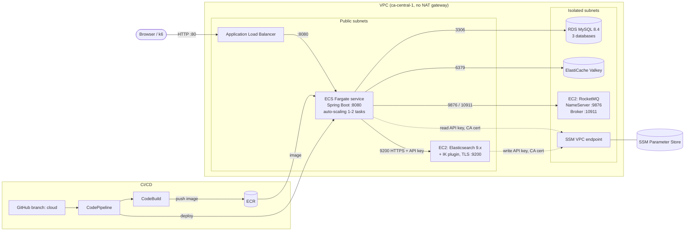
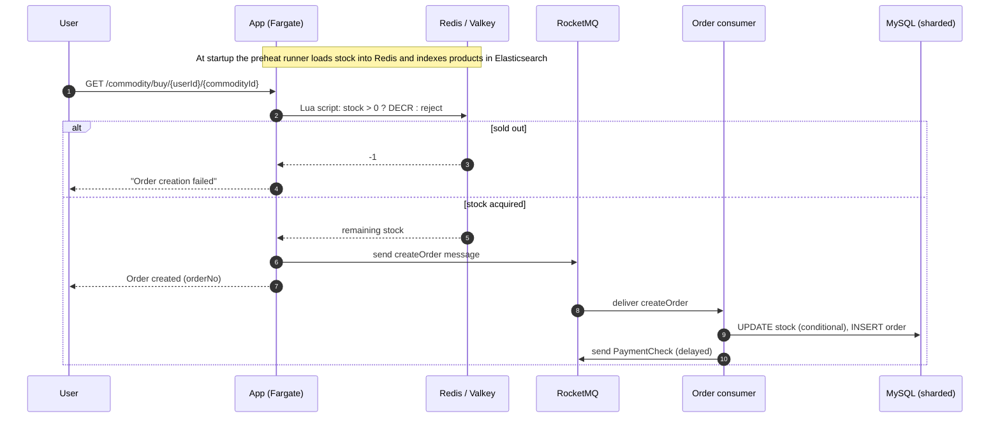
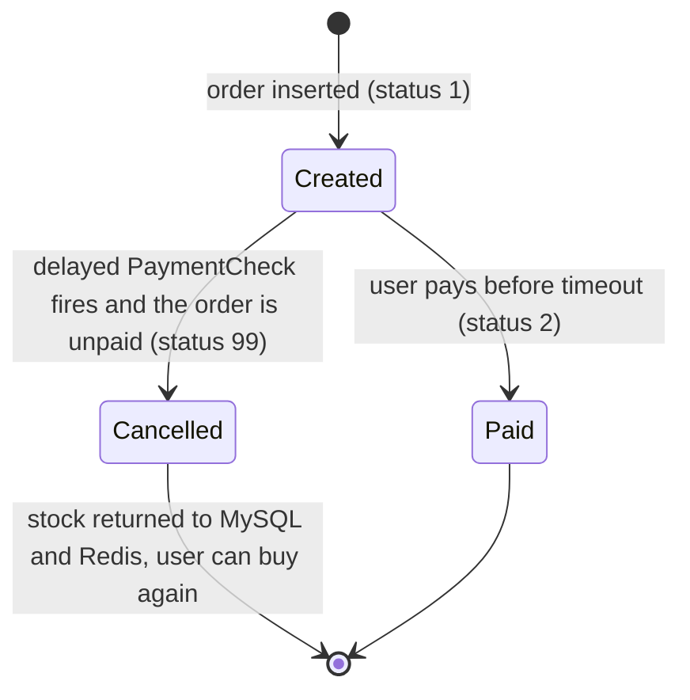
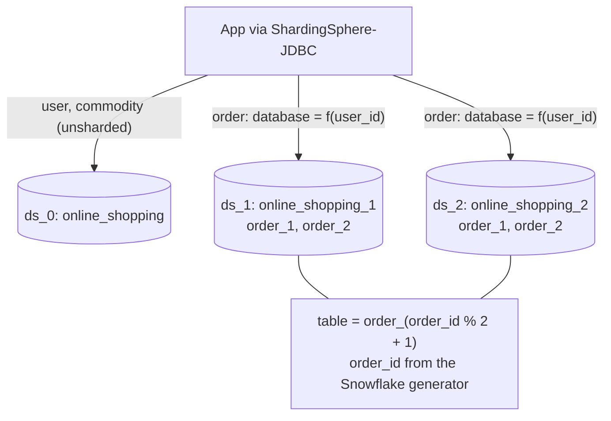
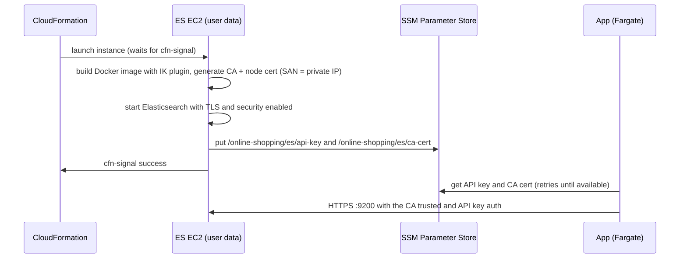

# OnlineShopping – High-Concurrency Flash-Sale Platform

## 1. Introduction

OnlineShopping is a flash-sale e-commerce backend built with **Spring Boot 4 (Java 17)**. It is designed so that a burst of buyers hitting a small amount of stock never oversells it, and the whole stack is defined as code and deployed to AWS with **CDK (TypeScript)**.

### Features

| Area | What it does |
|---|---|
| Product search | Full-text search over product name and description with **Elasticsearch** and the **IK** Chinese analyzer (`/search?desc=...`). English is not fully supported. |
| Oversell protection | Stock is preheated into Redis (Valkey) at startup. A **Lua script** checks and decrements it atomically, so only requests that win a unit of stock continue. |
| Async ordering | Winning requests are published to **RocketMQ**. A consumer persists the order and the DB stock change off the request path. |
| Payment timeout | Each order also sends a **delayed `PaymentCheck` message**. If the order is still unpaid when it fires, the order is cancelled and stock is returned to the DB and Redis. |
| Sharding | Orders are split across 3 MySQL databases and 2 tables each with **ShardingSphere-JDBC** (database by `user_id`, table by `order_id`). IDs come from a **Snowflake** generator. |
| Web UI | Simple server-rendered Thymeleaf pages: product list, product detail, add item, order result, order detail and pay. |
| Infrastructure as code | VPC, ALB, ECS Fargate (auto-scaling), RDS MySQL, ElastiCache Valkey, an Elasticsearch EC2 instance, a RocketMQ EC2 instance and a CodePipeline CI/CD pipeline, all in CDK. |
| Load test | k6 scripts in [`loadtest/`](loadtest/README.md). A 1,000-unit flash sale at up to 500 req/s produced exactly 1,000 orders, 0 oversold, p95 63 ms, p99 235 ms. |

### Main endpoints

| Endpoint | Purpose |
|---|---|
| `GET /search?desc=` | List products, or full-text search with `desc` |
| `GET /item/{commodityId}` | Product detail |
| `GET /addItem`, `POST /commodities` | Add a product |
| `GET /commodity/buy/{userId}/{commodityId}` | Buy (Redis deduction, then MQ) |
| `GET /commodity/orderQuery/{orderNo}` | View an order |
| `GET /commodity/payOrder/{orderNumber}` | Pay an order |
| `GET /hello` | Health check (used by the ALB) |

---

## 2. Deployment

Everything deploys to **AWS `ca-central-1`** with CDK. The only resource you must create by hand is a pre-baked RocketMQ image. Everything else (including Elasticsearch with the IK plugin and TLS) is built by the stacks.

### 2.1 Prerequisites

- An AWS account and credentials configured locally (`aws configure`, or SSO).
- Node.js 20+ and npm.
- Docker running locally. CDK builds the app image from the root `Dockerfile` and pushes it to ECR.
- AWS CLI v2.
- *(Optional, for CI/CD)* a GitHub token stored in Secrets Manager. See [2.5](#25-optional-cicd-pipeline).
- JDK 17 and Maven only if you run the app or tests locally. Newer JDKs, such as 23, break Lombok.

### 2.2 Pre-bake the RocketMQ image (the only manual prerequisite)

The VPC has no NAT gateway, so the RocketMQ EC2 instance cannot pull images at boot. Build an AMI once, with RocketMQ already running in Docker.

1. Launch a temporary **Amazon Linux 2023** EC2 instance in `ca-central-1`, in a subnet with internet access.
2. Install Docker and pull the image:
   ```bash
   sudo dnf install -y docker
   sudo systemctl enable --now docker
   sudo docker pull apache/rocketmq:5.3.1   # any 5.x tag; use the same tag below
   ```
3. Create the broker config. The CDK user data rewrites `brokerIP1` with the instance's private IP at boot, so the file **must** be at this exact path and contain a `brokerIP1=` line:
   ```bash
   cat > /home/ec2-user/broker.conf <<'EOF'
   brokerClusterName=DefaultCluster
   brokerName=broker-a
   brokerId=0
   autoCreateTopicEnable=true
   brokerIP1=127.0.0.1
   EOF
   ```
4. Start the NameServer and Broker with a restart policy, so they come back after the Docker restart in the user data:
   ```bash
   sudo docker run -d --name rmqnamesrv --restart always -p 9876:9876 \
     apache/rocketmq:5.3.1 sh mqnamesrv

   sudo docker run -d --name rmqbroker --restart always \
     -p 10909:10909 -p 10911:10911 -p 10912:10912 \
     -v /home/ec2-user/broker.conf:/home/rocketmq/broker.conf \
     -e NAMESRV_ADDR=<instance-private-ip>:9876 \
     apache/rocketmq:5.3.1 sh mqbroker -c /home/rocketmq/broker.conf
   ```
   `NAMESRV_ADDR` can be any value. The app only uses the NameServer address (`:9876`), and the broker advertises its address through `brokerIP1`.
5. Verify, then create the image:
   ```bash
   sudo docker ps    # both containers are "Up"
   ```
   In the EC2 console choose **Actions → Image and templates → Create image**. Wait until the AMI is *Available*, then terminate the temporary instance.
6. Put the AMI ID into the code (see the first marker below).

> The app uses these RocketMQ topics: `createOrder` (consumer group `orderGroup`) and `PaymentCheck` (`PaymentCheckGroup`). With `autoCreateTopicEnable=true` they are created on first use.

### 2.3 Where to change the code

| # | File | What to change |
|---|---|---|
| 1 | `infra/lib/data-stack.ts` (the `mqMachineImage` block) | **Required.** Replace `"ca-central-1": "ami-0dee711345ddec23d"` with your RocketMQ AMI ID. |
| 2 | `infra/bin/infra.ts` | Region is hard-coded as `ca-central-1`. Change it if you deploy elsewhere (and make the AMI available in that region). The account comes from `CDK_DEFAULT_ACCOUNT`. |
| 3 | `infra/lib/data-stack.ts` (`rds.Credentials.fromPassword`) and `infra/lib/ecs-stack.ts` (`DB_PASSWORD`) | **Recommended.** The DB password is the demo value `rootroot`. Use a stronger password (or Secrets Manager) in both places. |
| 4 | `src/main/resources/application.properties` (`security.jwt.secret-key`) | **Recommended.** Replace the committed JWT signing key. |
| 5 | `infra/lib/cicd-pipeline.ts` | Only for CI/CD: set `owner`, `repo`, `branch` (`cloud`) and the Secrets Manager secret name `onlineshopping-github`. |
| 6 | `infra/lib/ecs-stack.ts` | Optional: `desiredCount`, `cpu`, `memoryLimitMiB`, and the auto-scaling `minCapacity`/`maxCapacity`. |
| 7 | `infra/lib/data-stack.ts` | Optional: Elasticsearch instance size, heap size and the IK plugin URL. The plugin version must match the Elasticsearch version. |

Everything else is wired automatically: the stack passes the RDS, Valkey, RocketMQ and Elasticsearch addresses to the app as environment variables (`DB_HOST`, `REDIS_HOST`, `ROCKETMQ_NAME_SERVER`, `ES_HOST`, …). `app.env` in the repo root is only for running the app locally and is git-ignored.

### 2.4 Deploy

```bash
cd infra
npm install

# One-time per account/region
npx cdk bootstrap

# Review what will be created
npx cdk diff

# Deploy all stacks (EcrStack, NetworkStack, IamStack, DataStack, EcsStack, CICDPipeline)
npx cdk deploy --all --require-approval never
```

Notes:
- The `DataStack` waits for the Elasticsearch instance to finish bootstrapping (Docker build with the IK plugin, TLS certs, API key written to SSM Parameter Store). Expect roughly 5 to 10 minutes.
- The `EcsStack` runs a one-off Fargate task that creates the 3 databases and tables from `infra/init_task/init.sql`.
- On success the stacks print the `LoadBalancerURL` output. Open it in a browser, or:
  ```bash
  curl http://<LoadBalancerURL>/hello
  ```

Useful follow-ups:

```bash
# Restart app tasks (for example after Elasticsearch was replaced)
aws ecs update-service --cluster <cluster-name> --service <service-name> \
  --force-new-deployment --region ca-central-1

# Tear everything down
npx cdk destroy --all
```

### 2.5 (Optional) CI/CD pipeline

`CICDPipeline` watches the GitHub `cloud` branch, builds the Docker image in CodeBuild, pushes it to ECR and rolls it out to ECS. Before deploying it, store a GitHub personal access token in Secrets Manager:

```bash
aws secretsmanager create-secret --name onlineshopping-github \
  --secret-string '{"onlineshopping-github":"<github-token>"}' --region ca-central-1
```

The pipeline only swaps the container image. Changes to environment variables or infrastructure take effect only through `npx cdk deploy`.

### 2.6 Run locally

```bash
export JAVA_HOME=$(/usr/libexec/java_home -v 17)   # macOS; any JDK 17 works
mvn -q test                                        # tests
mvn spring-boot:run                                # app on :8080
```

Locally the app reads `DB_HOST`, `REDIS_HOST`, `ROCKETMQ_NAME_SERVER`, `ES_HOST`/`ES_PORT`, `ES_API_KEY` (or `ES_API_KEY_PARAMETER`) and `ES_CA_CERT_PEM` from the environment, for example from `app.env`. Defaults point at `localhost`.

### 2.7 Load test

See [`loadtest/README.md`](loadtest/README.md). In short, run k6 from an EC2 instance in the same region:

```bash
cd loadtest
./scripts/seed_stock.sh
k6 run -e BASE_URL=http://<alb-dns> -e STOCK=1000 -e COMMODITY_ID=1001 -e PEAK_RPS=500 k6/buy_spike.js
PURCHASED=<n> ./scripts/verify.sh
```

---

## 3. System architecture

### 3.1 AWS infrastructure



Security groups only allow the app to reach RDS, Valkey, RocketMQ and Elasticsearch, and only the ALB is exposed to the internet on port 80.

### 3.2 Request flow: flash-sale purchase



### 3.3 Order lifecycle and payment timeout



### 3.4 Data layout (ShardingSphere)



Because `user_id` is a sharding column, SQL that updates an order must not `SET user_id`. Include `user_id` in the `WHERE` clause so the query routes to a single database.

### 3.5 Elasticsearch bootstrap and trust



---

## Project layout

```
src/main/java/...        Spring Boot app (controllers, services, RocketMQ listeners, config)
src/main/resources/      application.properties, ShardingSphere config, MyBatis mappers, Thymeleaf templates, static CSS
infra/                   CDK app (bin/infra.ts, lib/*-stack.ts, init_task/ for DB schema)
loadtest/                k6 load test and verification scripts
Dockerfile               Multi-stage build of the app image
```
